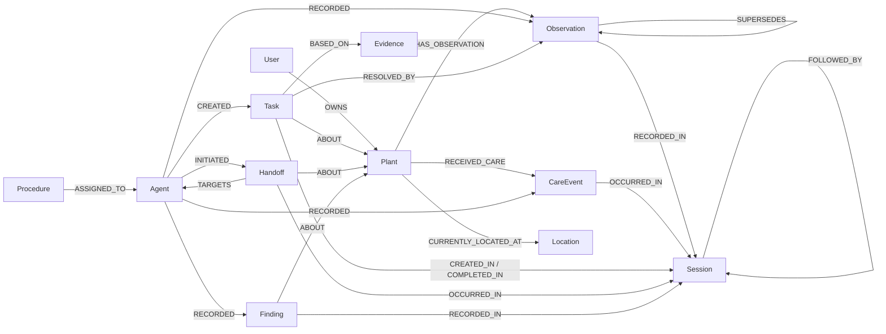

# Rooted

**Shared memory for continuous plant care**

Team CapybaraBR | Track 2: Agent Memory and Coordination

*Care rooted in memory.*

Rooted is a plant-care app built around persistent, connected history. Its Care, Observation, and Coordinator agents share a FalkorDB graph, so a care event recorded in one session can inform a follow-up in another. Users can inspect the history and ask questions whose answers depend on relationships between events.

Rooted records information supplied by the user. It does not diagnose plant diseases, identify species, or evaluate plant photos.

## What Rooted demonstrates

- **Memory across sessions:** care events, observations, tasks, and handoffs are linked to sessions and remain in FalkorDB.
- **Shared agent state:** the Care Agent and Observation Agent pass recorded context to the Coordinator; the Coordinator can hand pending follow-ups to the Observation Agent when a new session starts.
- **Memory that changes over time:** new observations become current and link to the previous observation with `SUPERSEDES`; tasks retain their evidence and completion session.
- **Graph-based answers:** a fixed catalog of tools runs parameterized graph traversals. Answers include the path and a trace of the tool, arguments, duration, and number of rows.
- **Garden-level isolation:** each garden uses its own FalkorDB graph, such as `rooted:demo-garden`.

## Run locally

### Requirements

- Python 3.10 or newer
- Docker Compose

### 1. Start FalkorDB

```bash
docker compose up -d
```

The default local setup exposes FalkorDB on port `6379` and FalkorDB Browser on port `3000`.

### 2. Create a Python environment and install dependencies

Windows PowerShell:

```powershell
py -3 -m venv .venv
.venv\Scripts\Activate.ps1
python -m pip install -r requirements.txt
Copy-Item .env.example .env
```

macOS or Linux:

```bash
python3 -m venv .venv
source .venv/bin/activate
python -m pip install -r requirements.txt
cp .env.example .env
```

### 3. Configure the database

The copied `.env` defaults to the local Docker instance. For FalkorDB Cloud, replace the host, port, username, and password with the connection details from your instance. Put the hostname in `FALKORDB_HOST` without a scheme or port; set the port separately. Do not commit `.env` or share its password.

| Variable | Purpose | Local default |
|---|---|---|
| `FALKORDB_HOST` | FalkorDB hostname | `localhost` |
| `FALKORDB_PORT` | FalkorDB port | `6379` |
| `FALKORDB_USERNAME` | Optional database username; set for authenticated instances | unset |
| `FALKORDB_PASSWORD` | Optional database password | unset |
| `FALKORDB_GRAPH` | Name of the default graph | `rooted` |
| `ROOTED_IDLE_MINUTES` | Idle-time setting shown in the sidebar | `1440` |
| `ANTHROPIC_API_KEY` | Optional key for LLM-assisted tool selection and phrasing | unset |
| `ROOTED_LLM_MODEL` | Optional Anthropic model name | configured in `agents/llm.py` |

The LLM integration is optional. Without an API key, Rooted uses its rule-based router. When enabled, the model selects from the fixed tool catalog and may draft a sentence; it does not write Cypher, and its sentence is checked against the graph result.

### 4. Start the app

```bash
streamlit run app.py
```

On the default graph, Rooted creates its base data on startup: the demo user, three agents, procedures, locations, and three sample plants. Newly created garden graphs receive the base data but start without sample plants. Care events and observations are never loaded automatically.

## Try it in 2 minutes

1. In the sidebar, choose **Garden**, or open **Settings** and create a garden (for example, `judge1`). A new garden starts **empty**.
2. On **Home**, press **＋ Add Plant** and add a plant. Then open **My Plants → Record care** and record that it was watered.

## Demo walkthrough

This flow demonstrates persistent memory, agent coordination, and a traceable answer:

1. In **Record Care**, record that the Monstera was watered.
2. In **New Observation**, record that its soil is still moist. The Coordinator links the observation to the watering and creates or updates a soil-check task.
3. In **Tasks**, show the pending follow-up and its recorded evidence.
4. Click **Start New Session** in the sidebar. The Coordinator retrieves pending tasks and creates a handoff to the Observation Agent.
5. In **Agent Memory**, select the Monstera and show the new handoff in the Coordination panel. The Episodic, Semantic, and Procedural tabs show the three memory types represented by the app.
6. In **Ask the Graph**, ask: `What happened to the Monstera since it was watered?` Show the answer, graph path, and trace.
7. In FalkorDB Browser, inspect the connected records. For example:

   ```cypher
   MATCH (p:Plant {id: 'plant_monstera'})-[r]-(n)
   RETURN p, r, n
   ```

8. To demonstrate tenant isolation, switch to a second garden with its own plant data, then switch back and show that the first garden's history remains separate.

For a task-completion variation, record a later observation with a known soil status. The Coordinator can complete the pending soil-check task while preserving the previous observation and its session history.

### Start a new session

- **F5 or browser reload:** reuses the active session for the current server run.
- **Start New Session:** ends the active session and starts another without restarting Streamlit.
- **Restart the app server:** starts a new session for the new server run.

## How the agents work

- **Care Agent:** records a user-reported care event and hands its context to the Coordinator.
- **Observation Agent:** records user-provided soil, leaf, growth, pest, and note fields, then hands the observation to the Coordinator.
- **Coordinator Agent:** evaluates recorded graph context, updates tasks and plant status from user-reported information, and resumes pending tasks when a session starts.
- **Graph reasoning:** routes questions to a fixed set of tools, validates plant names against the graph, runs traversals, and returns an answer with its path. A stored `Finding` can be reused if no newer activity has occurred for that plant.

The Coordinator's task rules are workflow rules, not botanical recommendations. For example, a moist-soil observation recorded after watering can create a soil-check task; yellow or fallen leaves can create an inspection task; and an observation with a known soil or leaf status can answer a matching pending task.

## FalkorDB data model

FalkorDB is the primary store for the app's operational memory. Agents, procedures, sessions, plant records, tasks, handoffs, and findings are stored as graph nodes and relationships.



Key node labels are `User`, `Plant`, `Agent`, `Procedure`, `Location`, `Session`, `Observation`, `CareEvent`, `Task`, `Handoff`, and `Finding`.

### Memory types

| Memory type | Rooted representation | Examples |
|---|---|---|
| Episodic | Timestamped events linked to `Session` nodes | Care events, observations, task creation/completion, handoffs |
| Semantic | Plant facts and graph findings | Species, current location, user-reported light, Coordinator findings |
| Procedural | `Procedure` nodes assigned to agents | Event triggers and the action or handoff that follows |

### Graph queries used by the product

The graph reasoning catalog in `graph/tools.py` uses these traversals:

- **Why a task exists:** `Agent -> Task -> CareEvent/Observation -> Session`, with the task connected to its plant and evidence.
- **What happened after care:** a care event and later observations are related through their sessions and the `FOLLOWED_BY` session chain.
- **Observation history:** follows `SUPERSEDES` from the current observation to earlier observations.
- **Handoff trail:** follows `Agent -> Handoff -> Agent` and includes the affected plant and session.
- **Recall:** collects current observation, latest care, location, and pending tasks for a plant.

Read-only graph operations use FalkorDB's `ro_query` path. Writes use parameterized Cypher through `graph/db.py`; the LLM does not generate Cypher.

Two representative query templates from the product's tool catalog:

```cypher
// Trace the care and evidence behind a pending task.
MATCH path = (agent:Agent)-[:CREATED]->(task:Task {status: 'pending'})
  -[:BASED_ON]->(evidence:CareEvent)-[:OCCURRED_IN]->(session:Session)
MATCH (task)-[:ABOUT]->(:Plant {id: $plant_id})
RETURN nodes(path) AS chain, task.created_at AS created_at
ORDER BY created_at
```

```cypher
// Find observations recorded after a care event, across linked sessions.
MATCH (care:CareEvent {id: $care_id})-[:OCCURRED_IN]->(from:Session)
MATCH (:Plant {id: $plant_id})-[:HAS_OBSERVATION]->(observation:Observation)
  -[:RECORDED_IN]->(to:Session)
WHERE observation.recorded_at > care.performed_at
OPTIONAL MATCH trail = (from)-[:FOLLOWED_BY*1..2]->(to)
RETURN care, observation, nodes(trail) AS session_path, observation.recorded_at AS recorded_at
ORDER BY recorded_at
```

The traversal depth is validated and capped by the application before it is inserted into the variable-length relationship pattern. The live implementations are in `graph/tools.py`.

## Garden isolation

The default garden uses the graph named in `FALKORDB_GRAPH` (normally `rooted`). A named garden such as `Demo Garden` is slugged and stored in a separate graph, for example `rooted:demo-garden`. The sidebar garden selector and **Settings** page switch the active graph.

Garden separation is graph-level tenant isolation. The app does not currently provide user accounts or authentication; anyone with access to the running app can use its garden selector. The database credentials in `.env` authenticate the app to FalkorDB, not individual app users.

Each Streamlit script run selects its tenant graph through a context-local value. This prevents garden selection from being stored in one shared global variable. The project does not include a high-concurrency throughput benchmark.

## Optional demo data and reset

The Settings page no longer has a demo-data reset panel. For development, the CLI can load a deterministic scenario:

```bash
python -m graph.seed --reset --demo 3
```

**Warning:** `--reset` deletes the currently selected graph before seeding. Use only on a disposable development graph. `--demo 2` stops with a pending follow-up; `--demo 3` includes a later observation.

## Tests

Start FalkorDB, activate the virtual environment, then run:

```bash
pytest
```

Database-backed tests use a separate graph named `rooted_test`. Tests marked `nodb` do not require FalkorDB.

## Project layout

```text
app.py                 Streamlit entry point
pages/                 Home and feature pages
agents/                Care, Observation, Coordinator, and graph reasoning agents
graph/                 FalkorDB connection, queries, seed data, and tool catalog
services/              Session, task, handoff, plant, and history services
ui/                    Shared layout, components, and theme
tests/                 Agent, reasoning, session, and tenant tests
assets/                Logo and plant images
```

**AI assistance disclosure:** Codex assisted with frontend implementation.
